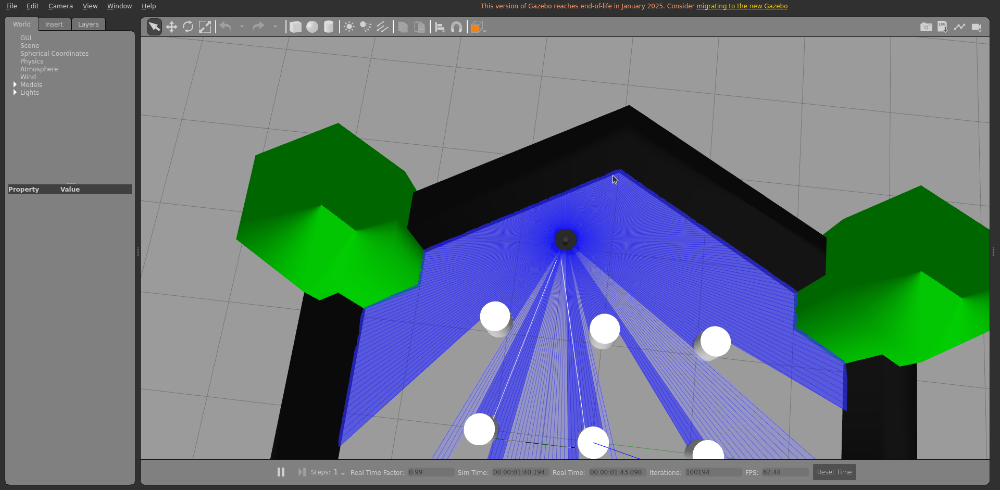
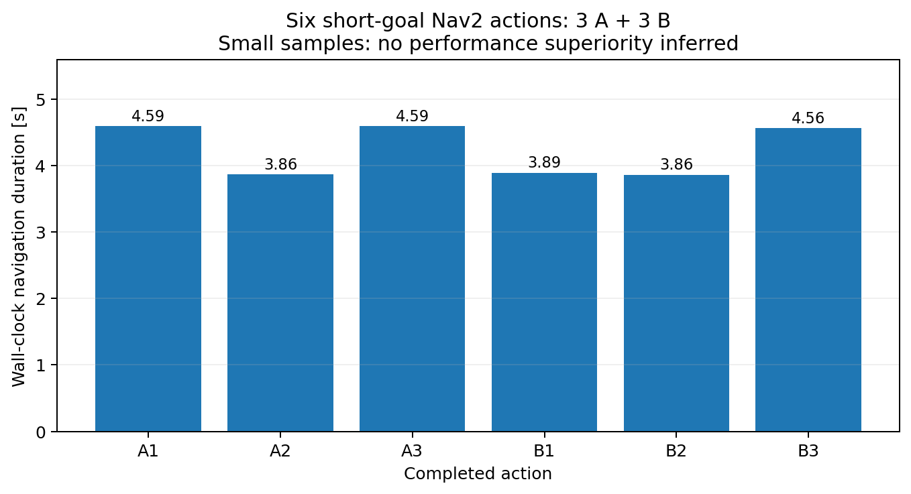
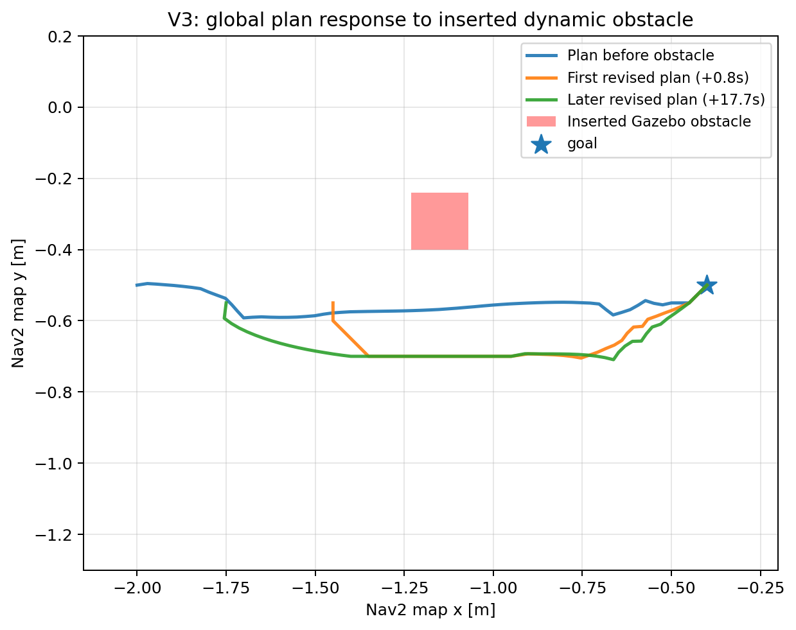
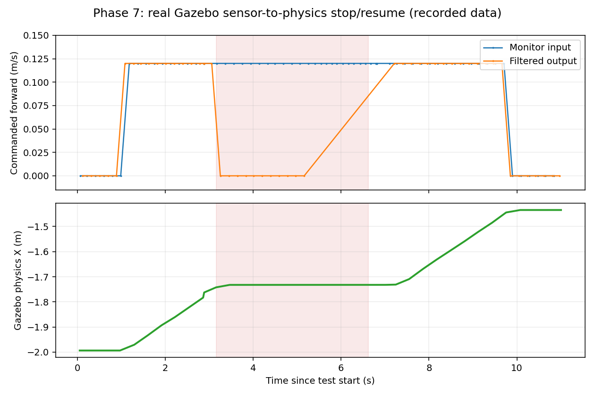

# TurtleBot3 Autonomous Navigation, Localization & Reactive Safety

**An evidence-driven ROS 2 robotics simulation study**

A simulated TurtleBot3 Waffle that **localizes on a known map, navigates with Nav2, responds to dynamically introduced obstacles, and stops when its front LiDAR safety region is occupied**. This repository emphasizes *controlled comparisons, independently checked robot poses, and transparent failure analysis* rather than a success-only demo.

**Implementation:** Dhruv Mistry (individual engineering work) · **Academic context:** Advanced Methods in Robotics, Group E, M.Sc. Intelligent Robotics, Deggendorf Institute of Technology (THD), WS 2026/27.

[**▶ Watch the genuine 47-second Gazebo + RViz demo**](assets/demo.mp4) · [Architecture](docs/architecture.md) · [Reproduction guide](docs/setup.md) · [Methods](docs/methodology.md) · [Results](docs/results.md) · [Technical Q&A](docs/faq.md)

## Engineering scope

| Capability | Approach | Validation |
|---|---|---|
| Autonomous goal navigation | Nav2 planner, controller, costmaps | **6/6** successful A/B navigation actions |
| Localization | AMCL on known occupancy map | Timestamp-aligned comparison against Gazebo P3D ground truth |
| Local state estimation | Baseline wheel odometry vs. EKF-fused wheel odometry + IMU | **3 matched actions per condition** |
| Dynamic obstacle response | Obstacle models spawned while Nav2 was navigating | **5 trials**, including a failure and a false-positive action result |
| Front-zone reactive stop | Real Gazebo LaserScan → Nav2 Collision Monitor → differential-drive command | **21/21** zero outgoing commands in GUI hazard run |
| Evidence capture | Gazebo physics pose, ROS bags, plots, offline verification | Raw execution history retained outside the public repository |

### Verified numbers, with their limits

| Experiment | Condition A | Condition B |
|---|---:|---:|
| Navigation action successes | 3/3 | 3/3 |
| Mean action time | 4.347 s | 4.104 s |
| Exploratory aligned map-frame XY RMSE | 0.01518 m, 5 pose pairs | 0.01360 m, 6 pose pairs |

**Do not interpret these as proof of EKF superiority.** AMCL provides global localization in *both* conditions; EKF only changes local odometry estimation in B. The short ground-truth runs used locally calibrated geometry on a 0.05 m occupancy grid and do **not** establish certified centimeter-level absolute accuracy.

## What changed between the two conditions?

- **A: baseline.** Gazebo wheel odometry produces odometry and publishes the odom-to-robot TF; AMCL provides map-to-odom TF.
- **B: EKF-assisted.** The robot_localization EKF fuses odometry and IMU; Nav2 consumes filtered odometry, and EKF alone publishes odom-to-robot TF. AMCL still provides map-to-odom TF.
- The Gazebo model for B is copied and modified to disable Gazebo's competing odometry TF. No duplicate TF publishers are intended.

## Obstacle trials: report the difficult cases

Five dynamic-obstacle experiments were recorded. A wide centered obstruction failed, and another run reported Nav2 action success despite the simulated robot remaining approximately **0.85 m** from the target. With the final offset-obstacle geometry, **3/3** subsequent runs passed the defined action **and** physical-pose sanity checks (mean unadjusted world-XY goal separation approximately **0.04324 m**).

**The lesson:** an action result is not a sufficient physical outcome metric.

## Stop / hold / resume in the simulator

A project-local Nav2 Collision Monitor uses real simulated <code>/scan</code> points in a forward polygon (<code>x = 0.10..0.50 m</code>, <code>y = ±0.28 m</code>). It filters incoming <code>/cmd_vel_pre_collision</code> to outgoing <code>/cmd_vel</code>.

In a fresh GUI experiment, the simulated robot moved **0.1877 m** on a clear path, held position with **21/21** zero outgoing velocity samples when an obstacle entered the safety polygon, and moved **0.2490 m** after the obstacle was removed.

**Important test boundary:** the safety run used a controlled 0.12 m/s command injected at the monitor input while Nav2 was active **but not running a navigation goal**. The Nav2 goal demonstration and the stop-and-resume demonstration in the MP4 are **two separate authentic runs**. This is simulation validation, not certified hardware emergency braking.

## Repository map

~~~text
.
├── README.md
├── config/                  # AMCL/Nav2 A/B parameters, EKF, Collision Monitor
├── launch/                  # Separate A/B and safety validation launch files
├── models/                  # Obstacle SDFs + modified upstream TurtleBot3 SDFs
├── scripts/                 # Experiments, demos, analysis and plot generation
├── data/                    # Curated CSV and verified JSON summaries
├── assets/                  # Genuine screenshots, video, measured plots
├── docs/                    # Architecture, setup, methodology, results, Q&A
├── tools/                   # Offline evidence validation (no ROS required)
└── .github/workflows/       # Syntax and evidence consistency checks
~~~

## Reproducing the simulation

Target environment: **Ubuntu 22.04 + ROS 2 Humble + Gazebo Classic 11**. The repo is **not a self-contained Docker image** and does not provide a guaranteed one-command installation; installed ROBOTIS TurtleBot3 and Nav2 packages are required. See [Setup and Reproducibility](docs/setup.md) for dependencies, launch entrypoints, expected topics, and known host-specific library caveats.

Run the published offline evidence validation without installing ROS. A CI workflow template is provided under `ci/`; it is not yet active on GitHub until the required workflow authorization is granted:

~~~bash
python3 tools/validate_evidence.py
python3 -m compileall -q scripts launch tools
~~~

## Design and scientific boundaries

- Simulated LiDAR, physics and robot only; **no hardware-tested safety certification**.
- Only three A/B actions per condition. Observed mean differences are descriptive.
- Reported localization RMSE uses **one short time-aligned run per condition**, not repeated absolute accuracy tests.
- Some useful rubric metrics (stationary covariance/stability and precise path deviation) remain unquantified.
- Gazebo Classic is an **end-of-life simulator**; it was used for compatibility with the ROS 2 Humble course environment, not as a recommendation for a new production stack.
- Some published scripts were **adapted to repo-relative paths for portability**. The full curated repo was syntax/evidence-checked, but not re-executed as an independent clean-machine integration test.

See [Methodology and Limitations](docs/methodology.md).

## Provenance, attribution and status

This public-facing repository is a **curated engineering implementation**, not a raw archive of the academic workstation. Internal logs, personal machine paths, package binaries, full ROS bags, and intermediate incident reports are deliberately excluded.

The implementation was completed independently by **Dhruv Mistry** for an academic **Group E** task. ROBOTIS TurtleBot3 assets and dependent ROS packages remain credited to their upstream maintainers; see [Attribution](docs/attribution.md). Project validation is complete to the scope documented above; course presentation/submission/grade is **not represented as confirmed**.
