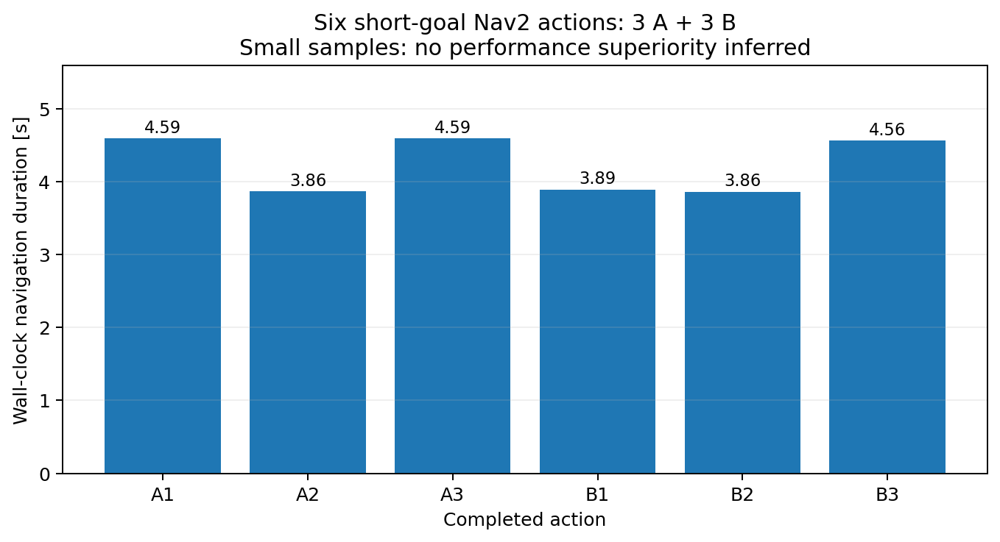
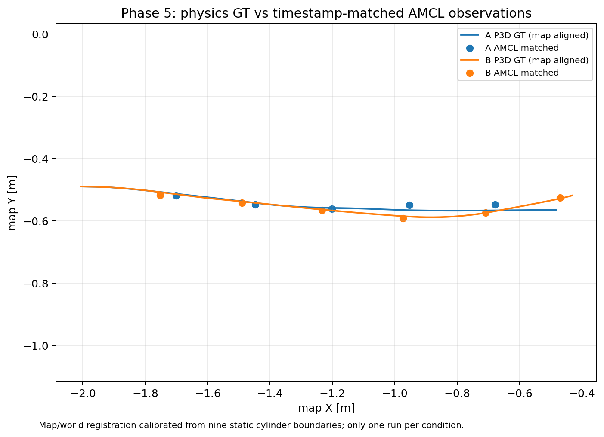
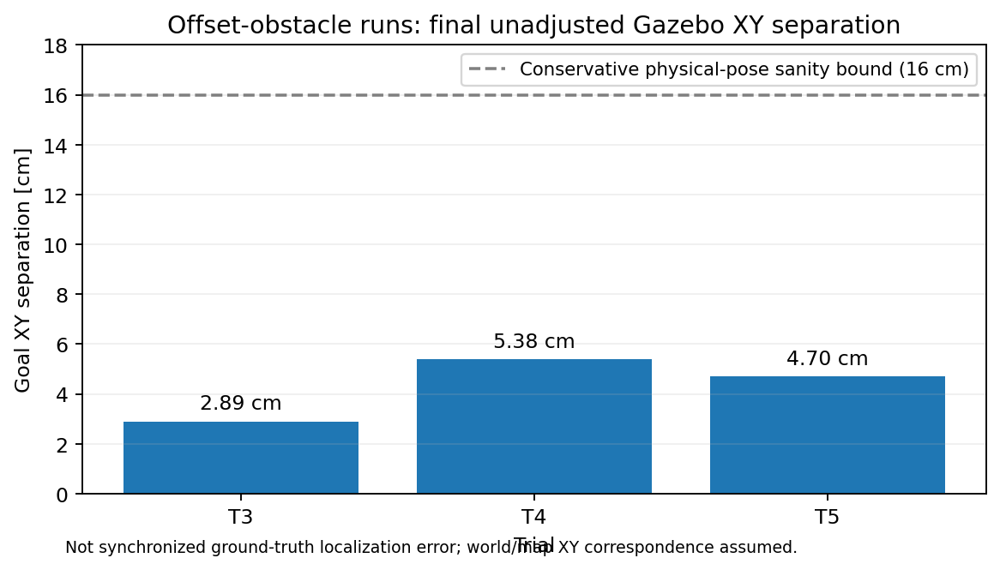
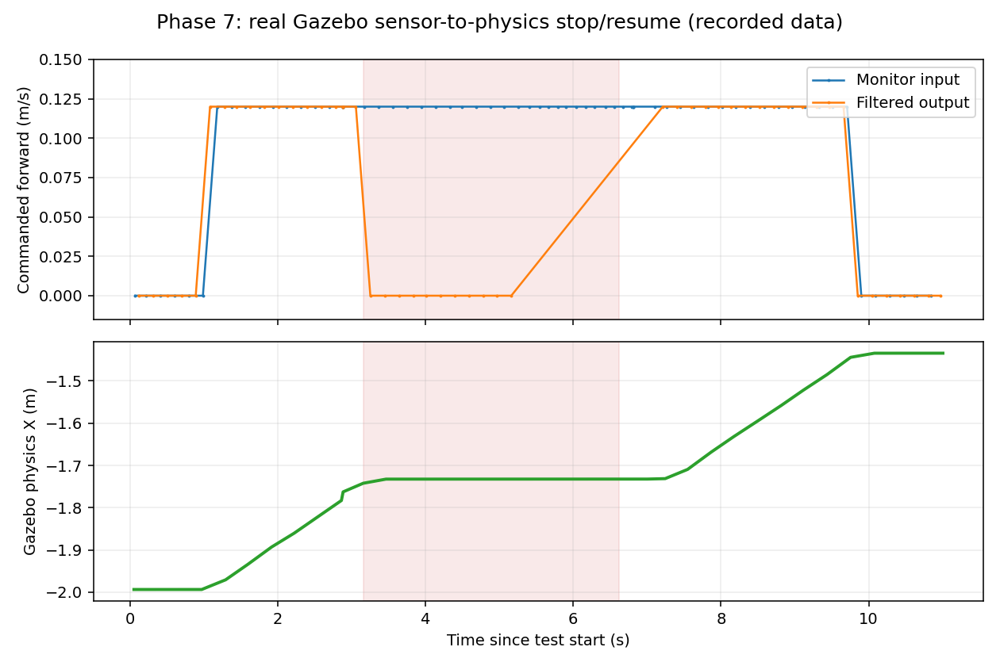

# Experimental results

All results are from ROS 2 Humble / Gazebo Classic simulation. JSON and CSV sources are under [data](../data/). No claim of external benchmark generalization is made.

## Controlled A/B navigation

| Measurement | A: Wheel odometry + AMCL | B: EKF odometry + AMCL |
|---|---:|---:|
| Matched goal actions | 3 | 3 |
| Nav2 SUCCEEDED | 3 | 3 |
| Mean action time | 4.347 s | 4.104 s |
| Global localization | AMCL | AMCL |
| odom→robot TF owner | Gazebo | EKF |

The mean difference is 0.243 s in these runs, **not** proof of statistical superiority. No confidence interval or significance claim is supported at n=3.

## Timestamp-aligned Gazebo ground truth

A P3D Gazebo plugin independently emitted physics pose data. The analysis locally registered nine cylinder collision boundaries against the occupancy map (resolution **0.05 m**), then matched AMCL header-stamped poses to interpolated physics timestamps (nearest ground-truth timestamp difference at most ~13–14 ms).

| Measurement | A | B |
|---|---:|---:|
| Ground-truth messages | 453 | 527 |
| Valid matched AMCL pairs | 5 | 6 |
| Map-frame XY RMSE | 0.01518 m | 0.01360 m |
| Map-frame XY MAE | 0.01440 m | 0.01274 m |
| Yaw MAE | 0.770° | 0.915° |

**Interpretation:** exploratory locally registered pose errors from **one instrumented run per condition**. Map registration is limited by grid resolution and geometry assumptions; do not call this survey-grade absolute accuracy.

## Five dynamic-obstacle trials

| Trial | Geometry | Nav2 action result | Final world-XY goal offset | Physical sanity |
|---|---|---|---:|---|
| 1 | Wide center | FAILED | 1.04763 m | Fail |
| 2 | Narrow center | SUCCEEDED | 0.85047 m | Fail |
| 3 | Offset | SUCCEEDED | 0.02893 m | Pass |
| 4 | Offset | SUCCEEDED | 0.05380 m | Pass |
| 5 | Offset | SUCCEEDED | 0.04699 m | Pass |

These final offsets are **uncalibrated world-XY-vs-map-goal consistency checks**, not a separate absolute localization RMSE. The script's sanity criterion includes distance below 0.16 m and limited pitch.

Trial 2 is especially useful failure evidence: an action-success result was inconsistent with simulated robot pose. For trials 3–5, action and pose checks passed; the mean final offset was approximately 0.04324 m. Recorded planning/costmap updates show response to obstacles but individual plan publications must not automatically be counted as distinct full replans.

## Collision Monitor: physical simulated stop and resume

The final recorded GUI trial used **real Gazebo simulated LaserScan**, real Gazebo physics, and an active Nav2 Collision Monitor. Incoming commands were **injected into the monitor's input**, rather than produced by a simultaneous Nav2 goal.

| Stage | Measured stop-monitor output | Gazebo XY displacement |
|---|---|---:|
| Clear before obstacle | 26/26 forward output samples | 0.1877 m |
| Hazard | 21/21 zero output samples | 0.0001 m |
| Obstacle removed | 32/32 forward output samples | 0.2490 m |

The original earlier headless trial contained a **post-stage shutdown-script exception**, preserved in the private full evidence archive; independent read-only rosbag analysis verified its physical stopping. A subsequent separate GUI trial exited **PASS** and provides the public evidence above.

## GUI Nav2 demonstration

The separate RViz GUI navigation demo sent an autonomous Nav2 goal and received **SUCCEEDED** in 6.326 s. An unadjusted world-XY goal separation of 0.11243 m met the exploratory 0.16 m physical sanity criterion. This demonstration was **not** counted as a new independent A/B replicate.

[Watch the two-run GUI demo](../assets/demo.mp4)

## Missing / deliberately unclaimed metrics

- Independent quantified stationary pose stability and covariance comparison
- Fully frame-calibrated trajectory-to-global-plan path deviation
- Hardware emergency-stop performance or safety certification
- A single continuous autonomous Nav2 goal *simultaneously* proving the stop-monitor gate and recovery

These remain appropriate extensions, not reported accomplishments.
